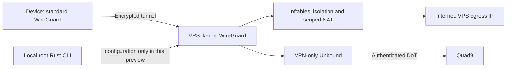

<div align="center">
  
  <h1>Shadowborn</h1>
  <p><strong>Your gateway. Your device keys. Standard WireGuard clients.</strong></p>
  <p>Rust control plane · Kernel WireGuard · nftables · VPN-scoped DNS over TLS</p>
  <p><a href="docs/installation-server.md">Server setup</a> · <a href="docs/client-enrollment.md">Enroll a device</a> · <a href="docs/no-logs-policy.md">No activity logs</a> · <a href="docs/validation.md">Validation</a></p>
</div>

Shadowborn is a self-hosted Internet gateway project using standard WireGuard
clients. It is not a commercial anonymity service. This checkout implements a
**provisioning preview**: configuration validation, device authorization, protected
configuration generation and separate server packaging. A disposable-VM manual
setup is documented. Automated live deployment and persistent strict client
protection are **not released**.

The established **Shadow Mist** local privacy/DoT client remains a separate
product in this workspace. Its binaries, services and configuration are preserved.
Server installation never installs or starts that client. Default Cargo commands
select the three Shadowborn crates; `--workspace` includes legacy compatibility
packages and their regression tests.

## What is implemented

| Capability | Current boundary |
| --- | --- |
| Rust `shadowborn` CLI | Independent of desktop NetworkManager and Shadow Mist |
| Strict TOML validation | Mandatory peer isolation, no activity logs, authenticated DoT, explicit interfaces/admin CIDR |
| Device authorization | Per-device public key, unique IPv4 address, separate PSK; active/disabled/revoked state |
| Key handling | Native `wg` key generation; root-only state; redacted diagnostics; no secret argv |
| Provisioning | WireGuard, scoped NAT/firewall, Unbound and systemd configuration in a new private directory |
| Client enrollment | Device-generated keys preferred; optional age-encrypted server-generated profile |
| Backup / restore | age-encrypted configuration only; current revocations survive offline restore |
| Packaging | Separate file-only install/update/uninstall with ownership checks and protected rollback copies |
| Live apply / live peer administration | **UNSUPPORTED**; deployed-gateway changes are rejected |
| Strict client kill switch | **UNSUPPORTED**; standard profiles do not provide this guarantee |
| IPv6 | Full client route into tunnel; server forwarding blocked; dual-stack egress not implemented |
| Production / boot / no-log runtime certification | **NOT TESTED**; see the release matrix |

`peer add`, `disable`, `revoke` and `rotate-psk` change **offline provisioning
state**. They refuse a detected deployed gateway. Do not interpret them as live
revocation commands. Existing exported bundles must be retired after a change.

## Build and inspect

```bash
cargo build --locked --release
./target/release/shadowborn version
./target/release/shadowborn doctor
./target/release/shadowborn --config config/server.example.toml validate
./target/release/shadowborn --config config/server.example.toml plan --json
./target/release/shadowborn --config config/server.example.toml init --dry-run
./scripts/install-server.sh --dry-run
```

The example uses documentation IP addresses. Replace the endpoint, WAN and SSH
admin CIDR on a **fresh disposable server VM**, with a working console, before
provisioning. Install does not start services, open ports, enable forwarding,
replace DNS or apply networking. Follow [server installation](docs/installation-server.md)
and [client enrollment](docs/client-enrollment.md) separately.

## Architecture



The ISP can see the VPN endpoint and timing. The VPS provider can observe egress
metadata. Websites see the server IP and can still identify accounts/browsers.
HTTPS protects application content independently of WireGuard. There is no
claim of anonymity, uninterrupted connectivity or protection against privileged
malware. A server firewall cannot prevent bypass on a disconnected client.

## No retained activity history

Shadowborn's state contains configuration, keys, assigned addresses and
revocation state. It has no browsing, DNS, session, handshake or traffic history.
Generated DNS configuration disables query/reply logging, syslog and periodic
statistics; owned service output is suppressed. There is no web API, telemetry,
exporter or background controller. Runtime behavior across reboot/failures still
requires validation. Global OS/security/provider logging is outside this policy.
Read the precise [no-logs policy](docs/no-logs-policy.md).

## Commands and recovery

`version`, `doctor`, `validate`, `init --dry-run`, `plan --json`, `apply --dry-run`,
`status`, `server status`, `dns status`, `client lockdown plan/status` and
`uninstall --plan` are inspection commands. Status reports `UNKNOWN` or
`NOT_TESTED` for unmeasured runtime properties.

Root-only provisioning commands: `init`, `render --output`, `peer add/list/show`,
`peer disable/revoke/rotate-psk --confirm`, `peer export-public`, `peer issue`,
`client profile`, `firewall plan`, `backup`, `restore --dry-run/--confirm`.
Run each command with `--help` for exact options. Unsupported activation fails
with a nonzero exit code. See [recovery](docs/admin-recovery.md).

## Legacy Shadow Mist

`shadowmist` and `shadowmistd`, `/etc/shadowmist`, their units and
`scripts/install.sh` / `scripts/uninstall.sh` retain their original meaning.
They are not a VPN. See the [legacy guide](docs/legacy/README.md),
[legacy architecture](docs/legacy/architecture.md), [legacy recovery](docs/legacy/recovery.md)
and [migration plan](docs/migration.md). The server does not import legacy host
integration code. No remote or GitHub setting is changed by this migration.

## Development and release gates

```bash
./scripts/validate.sh
python3 tests/namespaces/shadowborn.py
```

Tests distinguish pure policy/storage tests, file staging, isolated namespace
traffic, and full VM/hardware scenarios. A green unit suite does not certify a
kill switch. [Validation](docs/validation.md) records executed checks and gaps;
[performance](docs/performance.md) contains no invented benchmark numbers.

Additional documentation: [threat model](docs/threat-model.md),
[security hardening](docs/security-hardening.md), [DNS privacy](docs/dns-privacy.md),
[client kill switch](docs/client-kill-switch.md), [architecture](docs/architecture.md),
[reference design](docs/reference-mistborn.md), [Polish entry point](docs/README.pl.md).

## License and artwork

The checked-in [LICENSE](LICENSE) is AGPLv3; historical legacy package metadata
says MIT. New crates refer to the existing license file and are non-publishable.
This migration does not assert authority to relicense older code. Distribution
remains subject to the provenance reconciliation in [licensing](docs/licensing.md).
The existing repository icon is preserved without claiming new authorship.
