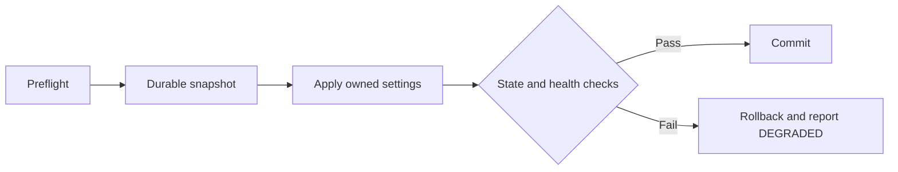

<div align="center">

  <a href="assets/shadow-mist-rounded-icon.png">
    
  </a>

  <h1>Shadow Mist</h1>

  <p><strong>Reversible network privacy for Linux.</strong></p>
  <p>Privacy you can verify. Connection you can keep. Changes you can undo.</p>

  <p>
    <a href="#project-status"></a>
    <a href="#requirements"></a>
    <a href="#requirements"></a>
    <a href="LICENSE"></a>
  </p>

  <p>
    <a href="#quick-start">Quick start</a> &nbsp;·&nbsp;
    <a href="#configuration">Configuration</a> &nbsp;·&nbsp;
    <a href="#command-reference">Commands</a> &nbsp;·&nbsp;
    <a href="docs/validation.md">Validation</a> &nbsp;·&nbsp;
    <a href="docs/README.pl.md">Polski</a>
  </p>

  <sub>NetworkManager · systemd-resolved · native systemd service · Rust</sub>

</div>

---

Shadow Mist brings local-link identity policies, authenticated encrypted system DNS,
and passive network assessment into one Linux service. Changes are explicitly
approved, recorded before execution, checked afterward, and reversible through
the same CLI.

It works with the host's existing network components. Traffic keeps using its
ordinary network path; Shadow Mist does not add a VPN, proxy, Tor circuit, or
proprietary gateway.

> [!IMPORTANT]
> **Development MVP.** Local automated checks and read-only Kali inspection have
> passed. Live DNS changes, Wi-Fi rotation, root-service sandboxing, and crash/boot
> recovery still require the isolated VM checklist. The production release gate
> remains open. See the [validation record](docs/validation.md).

## Contents

- [What it does](#what-it-does)
- [Quick start](#quick-start)
- [Requirements](#requirements)
- [Configuration](#configuration)
- [Command reference](#command-reference)
- [Service lifecycle](#service-lifecycle)
- [Identity and MAC rotation](#identity-and-mac-rotation)
- [Encrypted DNS](#encrypted-dns)
- [Status and automation](#status-and-automation)
- [Transactions and recovery](#transactions-and-recovery)
- [Updates and uninstall](#updates-and-uninstall)
- [Architecture](#architecture)
- [Development and validation](#development-and-validation)
- [Privacy boundaries](#privacy-boundaries)
- [Project status](#project-status)
- [Documentation](#documentation)

## What it does

| Capability | Current implementation |
| --- | --- |
| **Local network assessment** | Inspects devices, addresses, routes, resolver ownership, Wi-Fi profile security, local listeners, and compatibility indicators. |
| **Wi-Fi identity policy** | Sets `random`, `stable-ssid`, or `preserve` on explicitly enrolled, eligible NetworkManager profiles for their next activation. |
| **Ethernet identity policy** | Leaves the existing MAC policy untouched by default; randomization requires an explicit opt-in. |
| **Authenticated system DNS** | Integrates eligible connections with systemd-resolved DoT, approved resolver addresses, certificate hostnames, and health checks. |
| **IPv6 privacy** | Sets stable-privacy and temporary-address preferences on eligible profiles for their next activation, preserving IPv6 itself. |
| **Reversible changes** | Uses private ownership journals, compare-before-write checks, timed recovery for live changes, and conflict-aware restoration. |
| **Connection monitoring** | Debounces NetworkManager events, periodically assesses local state, and checks previously approved DNS policy. |
| **CLI and automation** | Provides human-readable reports, versioned JSON, redacted output, meaningful exit codes, and a status-only Unix socket. |

Wi-Fi scan-MAC effectiveness, DHCP/DUID rewriting, and local discovery hardening
are **audit-only or planned**. Strict DNS firewall enforcement is a later phase
and is rejected by the current configuration validator.

## Quick start

Run these commands from your local checkout. Start by building and inspecting;
use an isolated VM for the first live network changes.

### 1. Build and inspect

```bash
cargo build --locked --release --workspace

./target/release/shadowmist version
./target/release/shadowmist doctor
./target/release/shadowmist audit --json
./target/release/shadowmist status --json
```

The read-only commands work without the daemon. An unconfigured or incompatible
host can return exit code `2` with an honest `UNPROTECTED` or `UNCERTAIN` report.

### 2. Review installation and start the monitor

```bash
./scripts/install.sh --check
./scripts/install.sh --dry-run

sudo ./scripts/install.sh --profile balanced
sudo systemctl enable --now shadowmist-recover shadowmist
```

The installer prints prerequisite guidance and builds as the invoking
unprivileged user before final file installation. It preserves existing
configuration and registers the units. Profile enrollment and network
application are separate steps.

Starting the monitor begins observation and recovery of incomplete recorded
transactions. It does not enroll connections or rotate active interfaces.

### 3. Enroll a connection you own

List your profile UUIDs, then edit the installed configuration:

```bash
nmcli -g UUID,TYPE connection show
sudoedit /etc/shadowmist/config.toml
```

Replace the UUID placeholder below with the actual eligible profile UUID. For
DNS, choose two to four independent domains you approve for uncached health
lookups; the domains below are examples.

```toml
[general]
profile = "balanced"
enrolled_profiles = ["YOUR-PROFILE-UUID"]

[dns]
provider = "quad9"
health_domains = ["example.com", "example.net"]
```

These are sections to edit in the existing TOML file; each section should appear
only once. Leaving `health_domains = []` keeps DNS application disabled.

### 4. Preview, apply, and inspect

```bash
sudo shadowmist config validate
sudo shadowmist apply --dry-run --verbose
sudo shadowmist apply
shadowmist status --json

# Reload the monitor's configuration after editing TOML.
sudo systemctl restart shadowmist
```

Review all plan warnings before applying. `--verbose` exposes local identifiers
at the console. MAC and IPv6 policy changes take effect on the next activation;
eligible live DNS changes use their own health and rollback workflow.

## Requirements

| Component | Purpose |
| --- | --- |
| Linux, stable Rust **1.85+**, and a C linker | Build the workspace. Exact dependency versions are recorded in `Cargo.lock`. |
| systemd | Run the service and independent timed recovery. |
| NetworkManager and `nmcli` | Discover connections and manage enrolled profile settings through NetworkManager's APIs. |
| `busctl` | Inspect service capabilities and use NetworkManager checkpoints. |
| systemd-resolved and `resolvectl` | Provide the optional authenticated DoT integration and resolver health checks. |
| `ip` and `ss` | Inspect local addresses, routes, and socket state. |
| `nft` — optional | Read-only firewall inventory; the MVP installs no firewall rules. |

Capabilities are detected individually. The installer reports missing components;
it does not install dependency packages or migrate resolver ownership.

| Environment | Current verification / behavior |
| --- | --- |
| Kali 2026.3, x86_64, systemd, NM 1.58.1 | Build, automated checks, and real read-only discovery verified locally. |
| Kali / Debian-based host with the required stack | Initial target for live integration; the VM release checklist is pending. |
| Missing/inactive resolved or another resolver owner | DNS changes skipped with a reason; passive inspection remains useful. |
| Fedora / Arch | Planned tier 2; live integration not tested. |
| aarch64 | Cross-check job defined in CI; local cross-build/run not tested. |
| Containers, WSL, read-only systems, or missing systemd | Audit-only where feasible; unsupported host installation/mutations rejected. |
| systemd-networkd, other init systems, macOS, Android | No mutation adapter in the MVP. |

See the [compatibility policy](docs/compatibility.md) for the exact scope.

## Configuration

The installed configuration lives at `/etc/shadowmist/config.toml`. Start with
the commented [example configuration](config/shadowmist.example.toml).

### Profiles

| Profile | Behavior |
| --- | --- |
| `observe` | Passive inspection and reporting; no policy application. Existing persistent settings remain until explicitly restored. |
| `balanced` | Default after an explicit apply. Compatible settings are applied transactionally; failed owned DNS health can restore previous settings and report `DEGRADED`. |
| `strict` | Reserved for phase 2. The current CLI and validator reject it. |

```bash
sudo shadowmist profile set observe
sudo shadowmist profile set balanced
sudo systemctl restart shadowmist
```

Changing the selected profile saves configuration. Use `apply` or `restore`
explicitly for network changes.

### Key settings

| Setting | Default | Meaning |
| --- | --- | --- |
| `general.enrolled_profiles` | `[]` | Only listed eligible profile UUIDs may be changed. |
| `general.reconcile_seconds` | `120` | Periodic monitoring interval; accepted range is 15–3600 seconds. |
| `identity.wifi_mac` | `"random"` | Future-activation Wi-Fi policy; also accepts `stable-ssid` and `preserve`. |
| `identity.ethernet_mac` | `"preserve"` | Existing Ethernet MAC policy is left alone; `random` opts in. |
| `identity.wifi_scan_randomization` | `true` | Requests auditing; driver effectiveness remains unverified. |
| `dns.provider` | `"quad9"` | Also accepts `cloudflare` or authenticated `custom` endpoints. |
| `dns.health_domains` | `[]` | Explicitly approved health-query domains; empty disables DNS application. |
| `dns.health_timeout_seconds` | `8` | Timeout per approved lookup; accepted range is 2–15 seconds. |
| `ipv6.privacy_addresses` | `"prefer-temporary"` | Prefer privacy addresses on eligible future activations; `preserve` leaves preferences alone. |
| `logging.redact_sensitive_values` | `true` | Persistent logs stay redacted; use `--verbose` for sensitive console details. |

<details>
<summary><strong>Show the full default configuration</strong></summary>

```toml
schema_version = 1

[general]
profile = "balanced"
check_on_connect = true
network_scan = "passive"
reconcile_seconds = 120
enrolled_profiles = []

[identity]
wifi_mac = "random"
wifi_scan_randomization = true
ethernet_mac = "preserve"
rotate_on_daemon_start = false
rotate_active_connections = false
exclude_interfaces = ["lo", "docker*", "veth*", "br-*", "tun*", "wg*"]

[dns]
enabled = true
provider = "quad9"
transport = "dot"
verify_effective_state = true
balanced_restore_on_failure = true
custom_servers = []
health_domains = []
health_timeout_seconds = 8

[ipv6]
enabled = true
privacy_addresses = "prefer-temporary"

[network_audit]
include_listening_ports = true
check_gateway_changes = true
check_wifi_security = true

[logging]
level = "info"
redact_sensitive_values = true
```

</details>

Schema 1 rejects unknown fields, malformed TOML, future schema versions, and
unsupported combinations. Automatic rotation flags must stay `false`; `true` is
reserved and rejected. Required DNS verification and balanced rollback cannot
be disabled in the MVP. For a schema migration, retain a backup and follow
explicit migration instructions. Unsupported versions are rejected.

```bash
shadowmist config validate
shadowmist config show
shadowmist config show --json

# Inspect a different configuration without installing it.
shadowmist --config ./config/shadowmist.example.toml config validate
```

## Command reference

| Command | Purpose | Root |
| --- | --- | :---: |
| `shadowmist status` | Concise protection state, findings, and limitations. | No |
| `shadowmist status --json` | Versioned, sanitized machine-readable report. | No |
| `shadowmist doctor` | Component, capability, and compatibility checks. | No |
| `shadowmist audit --json` | Passive local network assessment. | No |
| `shadowmist interfaces --json` | Devices, capabilities, and exclusions. | No |
| `shadowmist dns status` | Effective resolver configuration and protection scope. | No |
| `shadowmist dns status --probe` | Fresh health lookups against approved domains. | No |
| `shadowmist identity status --verbose` | Effective MAC, available permanent-MAC information, and configured policy. | No |
| `shadowmist apply --dry-run` | Preview the current mutation plan. | No |
| `sudo shadowmist apply` | Apply the eligible plan transactionally. | Yes |
| `sudo shadowmist restore --dry-run` | Preview restoration from private ownership records. | Yes¹ |
| `sudo shadowmist restore` | Restore recorded settings without overwriting conflicting values. | Yes |
| `sudo shadowmist profile set balanced` | Save the selected profile. | Yes |
| `shadowmist config validate` | Validate schema and supported settings. | No |
| `shadowmist config show --json` | Display the parsed configuration. | No |
| `shadowmist version` | Display binary and status-schema versions. | No |

¹ A dry run performs no mutations, but reading the installed private journals
requires access to their directory. Inaccessible inspection data is reported
rather than guessed. `doctor`, `audit`, and `dns status` also accept `--json`.

## Service lifecycle

The native service is `shadowmist.service`; its daemon binary is `shadowmistd`.

```bash
sudo systemctl start shadowmist
sudo systemctl stop shadowmist
sudo systemctl restart shadowmist
sudo systemctl enable --now shadowmist
sudo systemctl disable --now shadowmist
systemctl status shadowmist
journalctl -u shadowmist -f
```

| Action | Result |
| --- | --- |
| Start / restart | Monitor connection events and check previously approved policy; active interfaces are not forcibly rotated. |
| Stop | Stop monitoring; persistent profile and DNS settings remain. |
| Enable / disable | Control boot startup; disabling the monitor does not deprovision configuration. |
| Restore | Explicitly undo settings recorded in Shadow Mist's ownership journals. |

The companion `shadowmist-recover.service` handles incomplete journals when
NetworkManager's API becomes available at boot. Its timing remains a VM release
gate. The daemon checks for incomplete transactions again at startup.

Reports under `/run/shadowmist` are sanitized for ordinary users. The root-owned
`0660` Unix socket accepts the single request `status\n`; mutations are available
only through the privileged CLI. Network identifiers stay out of normal logs.

## Identity and MAC rotation

Enrolled eligible Wi-Fi profiles use their configured MAC policy on **future
activation**. Stable-SSID support is checked using the installed NM parser.
Virtual devices, excluded interfaces, and enterprise/802.1X profiles are skipped.
Inactive profiles must be bound to a physical interface discoverable on the host.

```bash
shadowmist interfaces
shadowmist identity status --verbose
```

Immediate rotation is a separate, explicit reconnect workflow. Replace `wlan0`
with the actual eligible interface:

```bash
sudo shadowmist identity rotate \
  --interface wlan0 \
  --reconnect \
  --acknowledge-disconnect
```

> [!WARNING]
> Reconnection can interrupt SSH, VPNs, calls, and existing sessions. Remote
> administration indicators require the additional `--force-remote` override.
> Use a local console for initial testing and recovery.

The workflow requires the enrolled interface's random policy, a NetworkManager
checkpoint, and an independent recovery timer. It verifies that the effective
MAC changed to a locally administered unicast address, checks local routes, and
requests rollback on failure. Conflicting custom MAC-generation masks are
rejected. The random policy is retained for later activations.

MAC rotation changes local-link identity. The public IP, hostname, DHCP client
IDs, DHCPv6 DUID, accounts, and browser identity do not rotate with it.

## Encrypted DNS

The DoT adapter uses **systemd-resolved with authenticated TLS required**.
An opportunistic transport setting is not accepted as evidence of protection.

### Eligibility checks

DNS changes require all of the following:

1. The installed NM parser accepts required DoT settings and certificate-hostname endpoints.
2. systemd-resolved is active and NetworkManager uses its resolved DNS plugin.
3. `/etc/resolv.conf` points to resolved's **stub** configuration.
4. Exactly one ordinary physical connection is active, enrolled, and eligible.
5. VPN, split/search DNS, competing global/virtual-link DNS, or portal/limited-connectivity indicators do not make takeover incompatible.
6. Approved health domains and a local default route are available.

Unsupported combinations produce explicit skip reasons. Resolver migration,
`resolv.conf` replacement, and a global NetworkManager restart are outside the
application workflow. See [compatibility](docs/compatibility.md).

### Resolver presets

| Provider | Endpoint configuration |
| --- | --- |
| `quad9` — default | `9.9.9.9#dns.quad9.net`, `149.112.112.112#dns.quad9.net`, and the corresponding configured IPv6 endpoints. |
| `cloudflare` | Configured Cloudflare IPv4/IPv6 endpoints with the `cloudflare-dns.com` certificate hostname. |
| `custom` | Explicit `IP#certificate-hostname` entries in `dns.custom_servers`. |

For a custom resolver, configure actual reachable endpoints and certificate
hostnames you intend to trust. The provider can observe queries; preset selection
does not imply a no-logging guarantee.

<details>
<summary><strong>When are external health queries sent?</strong></summary>

Uncached DNS lookups are limited to the domains explicitly listed in
`dns.health_domains`. They occur during DNS application, explicit probes, and
monitoring of previously approved DNS policy. A normal passive status request
does not initiate a new health lookup.

```bash
shadowmist dns status --probe
shadowmist status --probe --json
```

The implementation checks required TLS policy, approved effective resolver
addresses and certificate names, DNS routing, and fresh resolution. This is
evidence within resolved's scope; it is not packet capture or proof that every
application uses that resolver. Browser/app DoH can follow a separate path.

Shadow Mist does not send HTTP probes, upload identifiers, collect credentials,
scan neighboring hosts, or invent a DNS encryption protocol.

</details>

In `balanced`, failure of owned DNS health requests restoration of the affected
transaction and reports `DEGRADED`. Previous/plaintext DNS may be active afterward.
A persistent degraded marker prevents automatic retry loops; inspect the result
and use explicit `apply` to retry. Conflicting values remain preserved for review.

## Status and automation

### Protection states

| State | Interpretation |
| --- | --- |
| `OBSERVE` | The selected profile is observational. |
| `UNPROTECTED` | Authenticated system DNS protection has not been established. |
| `CONFIGURED` | Effective resolver policy matches; no fresh successful upstream health check is attached to this observation. |
| `VERIFIED` | Fresh approved uncached lookups succeeded with authenticated DoT policy in effect. Scope remains the system resolver. |
| `UNCERTAIN` | Configuration or health could not be verified with available evidence. |
| `DEGRADED` | Fallback, drift, or recovery needs attention; inspect the reason and findings. |

Findings use `INFO`, `WARN`, `HIGH`, and `UNKNOWN`, with evidence and suggested
mitigation. Route changes and socket observations are indicators rather than
proof of an attack or of the absence of DNS leaks.

### Exit codes

| Code | Meaning |
| :---: | --- |
| `0` | Successful operation, observe mode, or verified state. |
| `2` | Partial, configured, uncertain, unprotected, or degraded result. |
| `3` | Invalid command input or configuration. |
| `4` | Unsupported feature or platform condition. |
| `5` | Operation, authorization, or recovery failure. |

JSON consumers should inspect `schema_version`, `state`, `dns`, and `findings`,
and accept additive fields within schema 1. Normal reports are redacted;
`--verbose` reveals local identifiers at the console. Diagnostics go to stderr.
The [status contract](docs/status-schema.md) documents the complete structure.

## Transactions and recovery

Every proposed mutation has a prior value, an owned target, and an explanation.
The privileged executor acquires the state lock and records durable intent
before changing settings.



Live DNS changes arm an independent **180-second** systemd recovery timer.
Explicit active rotation also uses a **90-second** NetworkManager checkpoint.
Incomplete journals survive process failure. Restore runs in reverse order and
compares current values before undoing them; later administrator changes cause
a conflict instead of an overwrite.

```bash
sudo shadowmist restore --dry-run --verbose
sudo shadowmist restore

# Recover incomplete recorded transactions after an interrupted operation.
sudo shadowmist recover
```

Restoring a profile does not force an already active MAC/IPv6 address to change;
those settings take effect on the next activation. Restore/recover can use the
journal even when the current configuration is malformed or unavailable.

> [!NOTE]
> Stopping the service is different from restoring settings. Reboot removes
> transient timers; boot recovery starts once NetworkManager is available and
> cannot promise restoration before its first activation. Crash/reboot behavior
> still requires the [VM checks](docs/validation.md).

Keep journals until restoration is complete. See [recovery procedures](docs/recovery.md)
for missing devices/profiles, conflicts, degraded state, and console recovery.

## Updates and uninstall

### Update an owned installation

```bash
sudo systemctl stop shadowmist
sudo ./scripts/install.sh --update
sudo systemctl start shadowmist
```

Updates verify installation ownership hashes, preserve existing configuration,
and retain replaced files under `/var/lib/shadowmist/install-backups`. Modified
installed files produce a conflict instead of being silently replaced.

### Restore and remove

```bash
sudo ./scripts/uninstall.sh --restore

# The installed uninstaller is also available outside the checkout.
sudo /usr/local/libexec/shadowmist/uninstall.sh --restore
```

Without a restoration flag, uninstall offers to restore first. `--keep-settings`
explicitly retains persistent policy. Config, journals, and backups are retained
for review; only unchanged manifest-owned installation files are removed.

<details>
<summary><strong>Stage an installation without changing the host</strong></summary>

```bash
SHADOWMIST_STAGE=$(mktemp -d)
./scripts/install.sh --destdir "$SHADOWMIST_STAGE"
./scripts/uninstall.sh --destdir "$SHADOWMIST_STAGE" --keep-settings
```

Staging builds and installs files under the selected prefix without registering
host units, applying network settings, or requiring root. The retained config
and backup files can be inspected in that directory afterward.

</details>

## Architecture

| Crate | Responsibility |
| --- | --- |
| `shadowmist-core` | Versioned configuration and reports, pure policy planner, reversible changes, and transaction state machine. |
| `shadowmist-platform-linux` | Capability discovery, bounded command execution, NM/resolved adapters, private storage, locks, and recovery. |
| `shadowmist-daemon` | Asynchronous events, debouncing, periodic assessment, owned-policy health checks, and sanitized status IPC. |
| `shadowmist-cli` | Direct passive inspection and explicit root-authorized mutations. |

```text
shadow-mist/
├── assets/                         # Repository artwork
├── config/shadowmist.example.toml  # Commented schema 1 configuration
├── crates/
│   ├── shadowmist-core/
│   ├── shadowmist-platform-linux/
│   ├── shadowmist-daemon/
│   └── shadowmist-cli/
├── docs/                           # Design, compatibility, recovery, validation
├── packaging/systemd/              # Monitor and boot-recovery units
├── scripts/                        # Installation and uninstallation
├── tests/                          # Fixtures, smoke suite, namespace test plan
├── .github/workflows/ci.yml
├── Cargo.toml
├── Cargo.lock
└── LICENSE
```

| Installed path | Contents |
| --- | --- |
| `/usr/local/bin/shadowmist` | Administrative CLI. |
| `/usr/local/sbin/shadowmistd` | Long-running monitor. |
| `/etc/shadowmist/config.toml` | Administrator-owned policy. |
| `/var/lib/shadowmist` | Private journals, ownership manifest, health marker, and backups. |
| `/run/shadowmist` | Sanitized runtime report and status-only socket. |
| `/usr/local/share/doc/shadowmist` | README, supporting documents, and repository artwork. |
| `/usr/local/libexec/shadowmist/uninstall.sh` | Installed uninstaller. |

The audited `nmcli` adapter uses NetworkManager's documented APIs; `nmcli monitor`
supplies events. Privileged commands use argument arrays and fixed executable
locations. Configuration/state permissions and authorization are checked before
mutations. See [architecture](docs/architecture.md) and the
[complete file inventory](docs/project-tree.txt).

## Development and validation

```bash
cargo fmt --all -- --check
cargo clippy --locked --workspace --all-targets -- -D warnings
cargo test --locked --workspace
cargo build --locked --release --workspace
sh -n scripts/install.sh scripts/uninstall.sh
python3 tests/integration/smoke.py
```

Recorded local validation on Kali 2026.3 / x86_64, Rust 1.97.1, and NM 1.58.1:

| Check | Recorded result |
| --- | --- |
| Rust unit tests | **34 passed** — 21 core and 13 Linux adapter/storage/report tests. |
| Integration smoke suite | **11 passed** — real passive commands, daemon IPC/lifecycle, and staged installation/update/removal. |
| Format and Clippy | **Passed**, with Clippy warnings treated as errors. |
| Release build | **Passed**, both binaries produced. |
| Shell syntax and systemd unit verification | **Passed**; unit executable paths pointed at the local build during verification. |

The simulated tests cover planning, idempotence, partial failure, interrupted
transactions, rollback conflicts, DNS-policy validation, redaction, and argument
boundaries. The smoke suite checks that dry runs and offline capability probes
leave the host's resolver contents and NM profile inventory unchanged.

Live DoT/TLS failures, real Wi-Fi hardware, IPv4/IPv6 interoperability, VPN/split
DNS preservation, root-service sandboxing, and reboot recovery remain **NOT
TESTED** in the required VM environment. Read the [validation record](docs/validation.md)
before treating the MVP as ready for production.

The [CI definition](.github/workflows/ci.yml) includes format, Clippy, tests,
release build, smoke checks, and an aarch64 cross-check. Its presence does not
imply an executed remote CI run.

For contributions, keep the planner pure, add meaningful coverage for changed
privileged behavior, document compatibility limits, and test network mutations
in isolated environments. [AGENTS.md](AGENTS.md) records the engineering rules.

## Privacy boundaries

Shadow Mist hardens selected local-network and system-resolver behavior. Its
protection scope is specific:

- **Public addressing and traffic metadata:** MAC changes do not change public
  IP. An ISP can still observe source/destination IPs, timing, volume, and some
  metadata clues. Encrypted DNS is not equivalent to a VPN.
- **Resolver visibility:** the selected DNS provider can learn queries. Choose
  the provider deliberately.
- **Applications and browsers:** custom DoH, embedded resolvers, hardcoded IPs,
  telemetry, logged-in accounts, and browser fingerprints remain outside these
  controls. Even future port-53 rules cannot universally enforce application DNS.
- **IPv6:** temporary addresses reduce identifier persistence; they do not hide
  routing prefixes or disable IPv6.
- **Network compatibility:** SSH, 802.1X, captive portals, registered MACs,
  reservations, and driver behavior can constrain deployment.
- **Evidence:** `VERIFIED` refers to fresh resolution under required authenticated
  resolved policy. It is not an anonymity guarantee, packet-capture evidence, or
  proof of no application leaks. The MVP has no DNS firewall enforcement.

The [threat model](docs/threat-model.md) explains the assets, controls, remaining
risks, and trusted components.

## Project status

| Phase | Scope | Status |
| --- | --- | --- |
| **0 — Foundations** | Workspace, configuration, capability discovery, passive reports, pure planner, simulated adapters. | Implemented; local checks recorded. |
| **1 — Usable MVP** | Service, enrolled MAC/IPv6 policy, conditional DoT, transactions/recovery, installation, explicit rotation. | Implemented; live VM release gate pending. |
| **2 — Advanced hardening** | Strict DNS nftables enforcement, better DHCP identity controls, timed portal exceptions, wider distro integration. | Planned; strict mode currently rejected. |
| **3 — Expansion** | Additional network/resolver adapters, protected optional startup-rotation workflows, optional TUI. | Planned. |

Track individual gates in the [implementation plan](docs/implementation-plan.md).
The repository does not assume a hosting account, published release, remote
repository, or downloadable package.

## Documentation

| Document | Read it for |
| --- | --- |
| [Polska instrukcja](docs/README.pl.md) | Skrócona instrukcja instalacji, obsługi i odzyskiwania po polsku. |
| [Architecture](docs/architecture.md) | Component boundaries, adapters, ownership, and recovery design. |
| [Compatibility](docs/compatibility.md) | Supported capabilities, exclusions, and verified versus untested environments. |
| [Recovery](docs/recovery.md) | Rollback, conflicts, interrupted operations, and uninstall. |
| [Status schema](docs/status-schema.md) | JSON fields, state semantics, exit codes, and migration policy. |
| [Validation](docs/validation.md) | Actual local results and the remaining isolated VM checklist. |
| [Threat model](docs/threat-model.md) | Privacy scope, adversaries, controls, and residual risks. |
| [Implementation plan](docs/implementation-plan.md) | Traceable tasks and release gates. |
| [Upstream references](docs/references.md) | NetworkManager, resolved, and resolver documentation consulted. |

## License

Project code is licensed under the [MIT License](LICENSE).

---

<div align="center">
  <sub><strong>Shadow Mist</strong> · Privacy you can verify. Connection you can keep. Changes you can undo.</sub>
</div>
