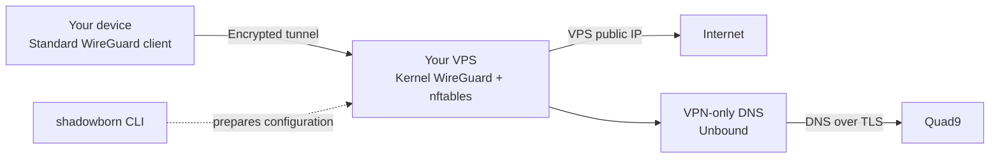

<div align="center">
  
  <h1>ShadowBorn</h1>
  <p><strong>Your devices. Your server. Your Internet gateway.</strong></p>
  <p>WireGuard · Rust · nftables · Unbound · DNS over TLS</p>
  <p>
    <a href="#getting-started">Get started</a> ·
    <a href="docs/installation-server.md">Server setup</a> ·
    <a href="docs/client-enrollment.md">Connect a device</a> ·
    <a href="docs/no-logs-policy.md">Privacy policy</a> ·
    <a href="docs/validation.md">Test results</a>
  </p>
</div>

**Shadowborn is a self-hosted WireGuard gateway project for routing your devices'
Internet traffic through a Linux VPS you control.** You authorize each device
with its own keys, connect using a standard WireGuard client, and use the VPS as
your Internet exit point.

The Rust CLI prepares the gateway's configuration, manages device authorization
before deployment, and produces protected server bundles and client profiles.
Packet forwarding runs through the Linux kernel, with nftables enforcing server
isolation and Unbound providing DNS through the tunnel.

> [!IMPORTANT]
> **Development preview.** The current implementation supports offline
> provisioning and a documented manual VM setup. Automated network activation,
> administration of a running gateway, and the persistent strict client kill
> switch are still unimplemented. Start with a disposable VM and the
> [server setup guide](docs/installation-server.md).

## How it works

A deployed gateway provides one encrypted connection between your device and your
VPS. The server forwards permitted Internet traffic through its public interface;
destinations receive connections from the VPS's public IP. DNS queries travel
inside WireGuard to the server's resolver, which forwards them to Quad9 using
authenticated DNS over TLS.



The configuration is provider-independent: you select the endpoint IP, WAN
interface, listening port, tunnel subnet and SSH administration range. The initial
evaluation targets are Debian and Ubuntu servers with systemd. No server OS
version is production-certified yet.

Client devices use standard WireGuard profiles. Linux clients can use `wg-quick`
and systemd without a custom client daemon. Other WireGuard applications are
best effort until their behavior has been tested.

## What Shadowborn provides

| Area | Available in this preview |
| --- | --- |
| **Server configuration** | Validated TOML and generated WireGuard, nftables, Unbound, forwarding and systemd configuration. |
| **Device authorization** | Individual public keys, unique tunnel IPv4 addresses, per-device preshared keys, and active/disabled/revoked states. |
| **Client profiles** | Templates for device-generated private keys, or an explicitly requested server-generated profile encrypted with age. |
| **Server isolation** | Generated rules restrict peer sources, deny peer-to-peer and private-network forwarding, block cloud metadata access, and scope NAT to the selected WAN. |
| **DNS configuration** | A tunnel-bound resolver with pinned Quad9 DoT upstreams and plaintext upstream fallback disabled. |
| **Protected state** | Private files, exclusive locks, atomic writes, ownership checks and redacted diagnostics. |
| **Backup and restore** | age-encrypted configuration backups; offline restore preserves current disabled and revoked authorizations. |
| **Packaging** | File-only installation, update and removal with ownership checks. Network activation is a separate operation. |

Peer changes currently update **offline provisioning state**. Operations refuse a
detected deployed gateway; changing a local record does not revoke credentials
on a running server. Retire stale exported bundles after authorization changes.

This preview provides **IPv4 Internet egress**. Generated client profiles route
both address families into the tunnel, while the server blocks IPv6 forwarding.
Routed IPv6 egress and persistent client protection remain unfinished. A standard
profile does not guarantee that traffic stays blocked when the tunnel is down.

## Getting started

Build with Rust/Cargo and a C linker. The packaging scripts also require Python 3.
Run the following from the repository root:

```bash
cargo build --locked --release

./target/release/shadowborn version
./target/release/shadowborn doctor
./target/release/shadowborn --config config/server.example.toml validate
./target/release/shadowborn --config config/server.example.toml plan --json

./scripts/install-server.sh --dry-run
```

These commands build the CLI, inspect prerequisites and display the proposed
configuration. The example contains documentation IP addresses: replace the
endpoint, WAN interface and administrator CIDR before provisioning your server.

The server runtime uses `wireguard-tools`, nftables, Unbound, CA certificates and
systemd; encrypted exports and backups use age. The
[installation guide](docs/installation-server.md) covers dependencies, private
state initialization, console access, configuration review and manual VM activation.

### From a server plan to a connected device

1. **Prepare the VPS.** Select the endpoint and interfaces, review existing
   firewall and DNS configuration, and verify console access before activation.
2. **Create the device identity.** Prefer generating the private key on the
   device and sending only its public key to the server administrator.
3. **Authorize the device.** Initialize the gateway state, add the public key,
   and generate a server bundle and client template.
4. **Review and activate in the VM.** Follow the server guide to install the
   generated configuration and start the standard services.
5. **Import the client profile.** Transfer the profile securely, complete it on
   the device, and verify the tunnel, Internet egress and DNS behavior.

The [client enrollment guide](docs/client-enrollment.md) gives the exact key and
profile workflow, including the optional encrypted convenience export. Linux
`DNS =` integration depends on the client's resolver setup and must be checked
before using the profile on a working workstation.

## CLI reference

| Task | Command |
| --- | --- |
| Inspect prerequisites | `shadowborn doctor` |
| Validate server configuration | `shadowborn validate` |
| Review a configuration plan | `shadowborn plan --json` |
| Initialize private gateway state | `sudo shadowborn init` |
| Authorize a device | `sudo shadowborn peer add --name laptop --public-key PUBLIC_KEY` |
| List authorized devices | `sudo shadowborn peer list` |
| Inspect a device with keys hidden | `sudo shadowborn peer show --name laptop --redacted` |
| Export a server review bundle | `sudo shadowborn render --output /root/shadowborn-review` |
| Export a client template | `sudo shadowborn client profile --name laptop --output /root/laptop.template` |
| Revoke an offline authorization | `sudo shadowborn peer revoke --name laptop --confirm` |
| Inspect reported status | `shadowborn status` |

Replace `PUBLIC_KEY` with the device's actual public key. State operations require
an initialized gateway and root access; the system configuration defaults to
`/etc/shadowborn/config.toml`. Profiles and review bundles contain secrets and
must remain outside Git.

Additional commands cover disabling devices, PSK rotation, public-key export,
encrypted profile issuance, backup and offline restore. Use
`shadowborn COMMAND --help` for their required arguments and the
[recovery guide](docs/admin-recovery.md) for backup and restore boundaries.

`apply --confirm` and `client lockdown enable` currently fail as unsupported.
Status reports `UNKNOWN` or `NOT_TESTED` for runtime properties it cannot verify;
a successful planning command is not evidence of a connected or protected client.

## Privacy and key custody

Shadowborn's stored state is limited to configuration, keys, assigned tunnel
addresses and authorization state. It does not include browsing history, DNS
query history, destination-flow history, handshake timelines or traffic counters.
There is no telemetry, analytics collector or background activity recorder.

Generated resolver configuration disables query/reply logging and periodic
statistics. Generated service configuration suppresses stdout/stderr and core
dumps. Runtime behavior through service failures and reboots still needs VM
validation; the [no-logs policy](docs/no-logs-policy.md) defines the exact scope.

Each device has a distinct keypair and PSK. Device-generated private keys stay on
the device in the preferred enrollment flow. The optional `peer issue` flow
requires explicit consent to generate a client key on the server and encrypts the
result to an operator-supplied age recipient. Backups contain necessary secrets
and authorization records, so their custody and retention matter too.

WireGuard protects the device-to-VPS connection. The local network and ISP can
still observe the VPN endpoint and traffic timing; the VPS provider can observe
egress metadata, and the upstream resolver receives DNS queries. Host OS and
provider logs remain outside this policy. HTTPS protects application content
independently. Account logins and browser identity remain
visible to the services you use. These boundaries are covered in the
[threat model](docs/threat-model.md).

## Validation and development

The recorded lab checks include a real kernel WireGuard tunnel, generated nftables
rules, IPv4 NAT and return traffic, selected host/metadata/source-spoofing blocks,
and traffic loss after explicit kernel peer removal. They use synthetic addresses
inside isolated namespaces.

Full VM boot/recovery, real Internet egress, authenticated DoT failure cases,
live durable revocation and strict client leak tests remain outstanding. No
throughput benchmark has been published. The
[validation matrix](docs/validation.md) records the evidence and remaining work.

```bash
# Build and test the Shadowborn packages.
cargo build --locked --release
cargo test --locked

# Check the complete workspace and packaging.
./scripts/validate.sh

# Run the isolated network lab when its prerequisites are available.
python3 tests/namespaces/shadowborn.py
```

The default workspace members are `shadowborn-core` for configuration and policy,
`shadowborn-platform` for protected storage and system-tool integration, and
`shadowborn-cli` for administration. Full workspace checks also cover retained
compatibility packages. See the [architecture](docs/architecture.md) for component
boundaries and the [compatibility guide](docs/legacy/README.md) when maintaining
an older installation.

## Documentation

| Guide | Contents |
| --- | --- |
| [Server setup](docs/installation-server.md) | Fresh VM preparation, dependencies and manual activation. |
| [Client enrollment](docs/client-enrollment.md) | Device keys, secure profile transfer and standard WireGuard import. |
| [DNS privacy](docs/dns-privacy.md) | Resolver configuration, encrypted upstreams and validation limits. |
| [Client protection](docs/client-kill-switch.md) | Requirements for the unfinished persistent strict mode. |
| [Administration and recovery](docs/admin-recovery.md) | Backups, revocation, recovery and removal. |
| [Security hardening](docs/security-hardening.md) | Host assumptions, permissions and service boundaries. |
| [Performance](docs/performance.md) | Measurement plan and current benchmark status. |
| [Polish introduction](docs/README.pl.md) | Krótkie wprowadzenie i odnośniki do instrukcji. |

## License

See the repository's [LICENSE](LICENSE) and
[package licensing notes](docs/licensing.md) for license terms and the outstanding
provenance reconciliation before distribution.
